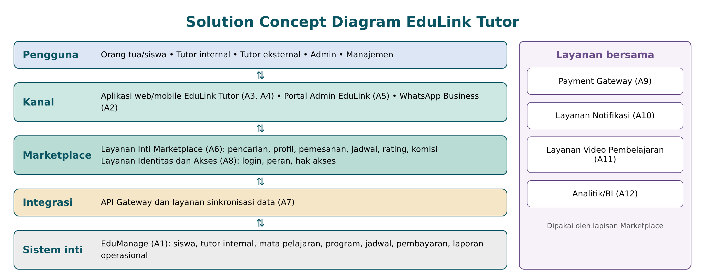

# Vision v1.0 EduLink Tutor

> **Versi:** 1.0 &nbsp;|&nbsp; **Pemilik dokumen:** CEO / Product Owner (Indah Khoerunisa) &nbsp;|&nbsp; **Status:** Disetujui mitra melalui surat konfirmasi No. 012/EDULINK-DIR/XI/2026 (21 November 2026)

Vision (pernyataan arah produk) merangkum masalah yang dijawab, nilai yang ditawarkan, dan lingkup produk. Isinya diturunkan dari visi perusahaan, daftar masalah, dan prinsip arsitektur pada fase **Architecture Vision (Phase A) TOGAF**.

## Daftar isi

1. [Latar belakang](#1-latar-belakang)
2. [Pernyataan visi](#2-pernyataan-visi)
3. [Masalah yang dijawab](#3-masalah-yang-dijawab)
4. [Nilai yang ditawarkan](#4-nilai-yang-ditawarkan)
5. [Lingkup MVP](#5-lingkup-mvp)
6. [Tiga KPI](#6-tiga-kpi)
7. [Prioritas fitur MoSCoW](#7-prioritas-fitur-moscow)
8. [Konsep solusi](#8-konsep-solusi)
9. [Application Portfolio](#9-application-portfolio)

---

## 1. Latar belakang

PT EduLink Teknologi Indonesia adalah perusahaan jasa pendidikan di Kota Jambi yang memiliki bimbingan belajar fisik untuk jenjang SD, SMP, dan SMA. Operasional perusahaan dikelola dengan sistem internal **EduManage**, sedangkan komunikasi dengan pelanggan dan tutor menggunakan **WhatsApp Business**. Karena EduManage hanya digunakan di dalam perusahaan, masyarakat belum dapat mencari tutor, melihat profil, membandingkan tarif, atau memesan les privat secara online.

**EduLink Tutor** dirancang untuk mengisi kekosongan tersebut tanpa menggantikan EduManage. Kedua sistem dihubungkan agar data siswa, tutor, mata pelajaran, jadwal, dan pembayaran tidak ganda atau berbeda antarsistem.

## 2. Pernyataan visi

> Menghadirkan akses tutor berkualitas bagi setiap siswa melalui layanan tatap muka dan digital yang terpercaya, dengan EduLink Tutor sebagai tempat bertemunya orang tua/siswa dan tutor.

## 3. Masalah yang dijawab

| No | Masalah | Dampak |
|:-:|---|---|
| P1 | Layanan hanya berpusat pada bimbel fisik | Pasar terbatas pada lokasi dan kapasitas bimbel |
| P2 | Calon pelanggan belum dapat mencari dan memesan tutor sendiri | EduManage hanya untuk internal, sehingga pemesanan masih melalui admin |
| P3 | Tutor eksternal belum punya jalur pendaftaran dan verifikasi yang terstandar | Perusahaan sulit menambah tutor baru dengan mutu terjaga |
| P4 | Pembayaran digital dan komisi belum didukung proses maupun sistem | Belum ada sumber pendapatan dari transaksi platform |
| P5 | Data siswa, tutor, dan jadwal berisiko ganda | Terjadi apabila platform baru berdiri sendiri tanpa terhubung ke EduManage |

## 4. Nilai yang ditawarkan

| Pihak | Nilai |
|---|---|
| **Orang tua / siswa** | Mudah mencari tutor terverifikasi, membandingkan tarif, dan memesan |
| **Tutor** | Kesempatan memperoleh siswa baru, tarif jelas, dan jadwal fleksibel |
| **Perusahaan** | Pasar lebih luas, pendapatan baru dari komisi, dan mutu tutor terjaga melalui verifikasi serta rating |

## 5. Lingkup MVP

MVP dikerjakan dalam empat minggu (P13 sampai P16) dengan data tiruan dan pembayaran sandbox (lingkungan percobaan tanpa uang sungguhan).

| Termasuk | Tidak termasuk |
|---|---|
| Akun dan login berbasis peran | Integrasi langsung ke EduManage yang sebenarnya |
| Pendaftaran dan verifikasi tutor | Pembelajaran online |
| Profil dan jadwal tutor | Laporan terpadu |
| Pencarian tutor | Penskalaan otomatis |
| Pemesanan dan persetujuan tutor | |
| Pembayaran uji coba (sandbox) | |
| Rating dan ulasan | |

## 6. Tiga KPI

KPI (Key Performance Indicator, ukuran keberhasilan utama) dipilih dari indikator keberhasilan pada Laporan Tugas Akhir. Target di bawah ditetapkan mitra untuk **periode UAT pada P15**. Target operasional setelah peluncuran akan ditetapkan pada fase implementasi.

| No | KPI | Cara mengukur | Target UAT (MVP) |
|:-:|---|---|---|
| 1 | Jumlah tutor terverifikasi | Jumlah tutor dengan status verifikasi "valid" pada platform | Minimal **30 tutor** berstatus valid pada data uji |
| 2 | Jumlah pesanan per bulan | Jumlah pesanan yang berhasil dibuat dan dibayar dalam satu bulan | Minimal **20 pesanan** uji berstatus dibayar selama periode UAT |
| 3 | Persentase pembayaran digital yang berhasil | Pembayaran berstatus "berhasil" dibagi seluruh percobaan pembayaran | Minimal **90%** pada pembayaran sandbox, di luar skenario gagal yang disengaja |

## 7. Prioritas fitur MoSCoW

MoSCoW mengelompokkan kebutuhan menjadi empat tingkat: **Must have** (wajib ada), **Should have** (sebaiknya ada), **Could have** (dapat dikerjakan jika waktu memungkinkan), dan **Won't have this time** (tidak dikerjakan pada tahap ini). Alur utama pencarian dan pemesanan dikerjakan lebih dahulu. Kode UC merujuk pada use case di folder `03_Application`.

| Kategori | Fitur atau kebutuhan | Alasan |
|---|---|---|
| **Must have** | • Registrasi dan login akun berbasis peran (UC01) • Pendaftaran dan verifikasi tutor (UC02, UC03) • Profil dan jadwal tutor (UC04) • Pencarian tutor (UC05) • Pemesanan dan persetujuan tutor (UC06, UC07) • Pembayaran uji coba (UC08) | Tanpa fitur ini alur utama tutor dan pemesanan tidak dapat berjalan |
| **Should have** | • Rating dan ulasan (UC09) • Pemantauan pesanan dan penanganan keluhan oleh admin (UC10) • Notifikasi sederhana | Penting untuk kepercayaan dan mutu, tetapi pemesanan tetap berjalan tanpanya |
| **Could have** | • Perhitungan komisi dan pencairan dana tutor • Tautan sesi pembelajaran online • Dasbor laporan ringkas | Bernilai, tetapi bergantung pihak ketiga atau memerlukan waktu lebih lama |
| **Won't have this time** | • Integrasi langsung ke EduManage yang sebenarnya (menggunakan data tiruan) • Single Sign-On penuh (login satu pintu antaraplikasi) • Load Balancer dan penskalaan otomatis | Memerlukan sumber daya dan akses yang belum tersedia, dan dijadwalkan pada tahap berikutnya sesuai peta jalan laporan |

Perubahan lingkup setelah surat konfirmasi mitra hanya dapat dilakukan atas persetujuan tertulis kedua pihak melalui CEO / PO, dan dicatat sebagai Change Request di folder `06_Governance`.

## 8. Konsep solusi

Solution Concept Diagram menggambarkan arsitektur target dalam enam lapisan: pengguna, kanal, marketplace, integrasi, sistem inti, dan layanan bersama.

| Lapisan | Elemen | Keterangan |
|---|---|---|
| Pengguna | Orang tua/siswa, tutor internal, tutor eksternal, admin, dan manajemen | Pihak yang menggunakan atau mengelola layanan |
| Kanal | Aplikasi web/mobile EduLink Tutor, portal admin, dan WhatsApp Business | Media akses pengguna dan sarana komunikasi |
| Marketplace | Pencarian tutor, pengelolaan profil, pemesanan, jadwal, rating, dan komisi | Layanan utama platform EduLink Tutor |
| Integrasi | API Gateway dan layanan sinkronisasi data | Penghubung pertukaran data EduLink Tutor dan EduManage |
| Sistem inti | EduManage | Sistem internal untuk data siswa, tutor internal, mata pelajaran, program, jadwal, pembayaran, dan laporan operasional |
| Layanan bersama | Pembayaran digital, notifikasi, video pembelajaran, dan analitik | Penunjang transaksi, komunikasi, pembelajaran online, dan pemantauan kinerja |

Pengguna mengakses layanan melalui kanal. Kanal terhubung dengan layanan marketplace untuk pencarian dan pemesanan tutor. Marketplace berkomunikasi dengan EduManage melalui lapisan integrasi dan memanfaatkan layanan bersama. Dengan susunan ini, EduLink Tutor menjadi produk layanan digital baru tanpa menggantikan sistem internal yang telah berjalan.

> **Catatan MVP:** pada MVP, lapisan integrasi belum terhubung ke EduManage asli. Datanya diganti data tiruan (seeder), sesuai status Won't have di atas.

## 9. Application Portfolio

Kode A1 sampai A12 digunakan sebagai rujukan di seluruh repositori.

| ID | Aplikasi | Fungsi | Status |
|:-:|---|---|:-:|
| A1 | EduManage | Administrasi siswa, tutor, mata pelajaran, program, jadwal, pembayaran, laporan operasional | Ada |
| A2 | WhatsApp Business | Komunikasi dengan pelanggan dan tutor | Ada |
| A3 | EduLink Tutor (aplikasi orang tua/siswa) | Pencarian, pemesanan, pembayaran, rating | Baru |
| A4 | EduLink Tutor (aplikasi tutor) | Profil, jadwal, terima pesanan, pencairan | Baru |
| A5 | Portal Admin EduLink | Verifikasi tutor, monitoring pesanan, keluhan | Baru |
| A6 | Layanan Inti Marketplace | Pencarian, pemesanan, rating, komisi | Baru |
| A7 | API Gateway dan Integrasi | Penghubung EduLink Tutor dan EduManage | Baru |
| A8 | Layanan Identitas dan Akses | Login, peran, hak akses | Baru |
| A9 | Payment Gateway | Pembayaran digital | Pihak ketiga |
| A10 | Layanan Notifikasi | Push, email, pesan WhatsApp | Baru, menggunakan A2 |
| A11 | Layanan Video Pembelajaran | Sesi online | Pihak ketiga |
| A12 | Analitik/BI | Laporan terpadu manajemen | Baru |

---

**Dokumen terkait:** [Stakeholder](02_Stakeholder.md) · [Team Charter](03_Team_Charter.md) · [Business Model Canvas](../01_Business/01_Business_Model_Canvas.md)
