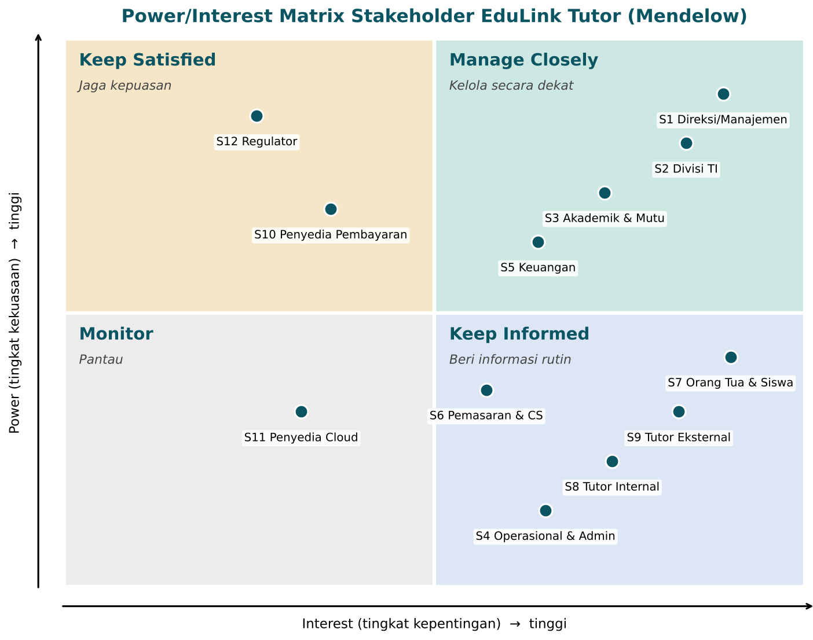

# Stakeholder EduLink Tutor

> **Pemilik dokumen:** CEO / Product Owner (Indah Khoerunisa) &nbsp;|&nbsp; **Fase TOGAF:** Phase A (Architecture Vision)

Dokumen ini mengidentifikasi pihak-pihak yang berkepentingan atau terlibat dalam pengembangan EduLink Tutor, lalu memetakan kekuasaan (power) dan kepentingan (interest) masing-masing untuk menentukan cara pelibatannya.

## Daftar isi

1. [Dasar identifikasi](#1-dasar-identifikasi)
2. [Katalog stakeholder](#2-katalog-stakeholder)
3. [Power/Interest Matrix](#3-powerinterest-matrix)
4. [Strategi pelibatan](#4-strategi-pelibatan)
5. [Keterlibatan stakeholder pada MVP](#5-keterlibatan-stakeholder-pada-mvp)

---

## 1. Dasar identifikasi

Kelompok pengguna (orang tua, siswa, tutor internal, tutor eksternal, dan manajemen) diidentifikasi dari skenario perusahaan. Unit internal, mitra, dan regulator lainnya merupakan asumsi penulis. Kepentingan dan pengaruh setiap stakeholder dianalisis dari peran dan keterlibatannya dalam pengembangan sistem.

Stakeholder dibagi ke dalam tiga kelompok:

| Kelompok | Stakeholder | Peran umum |
|---|---|---|
| Internal | S1 sampai S6 | Menentukan arah strategis, kebutuhan teknis, mutu tutor, operasional, dan keuangan |
| Pengguna | S7 sampai S9 | Menentukan keberhasilan platform melalui penggunaan layanan |
| Eksternal | S10 sampai S12 | Memengaruhi keamanan transaksi, ketersediaan infrastruktur, dan kepatuhan |

## 2. Katalog stakeholder

| Kode | Stakeholder | Kepentingan utama | Kekuatan dan pengaruh |
|:-:|---|---|---|
| S1 | Direksi / Manajemen | Pertumbuhan pasar, peningkatan pendapatan, pengembangan layanan baru, pengelolaan risiko, dan laporan kinerja perusahaan | Menentukan arah strategis, menyetujui investasi, dan mengambil keputusan terkait pengembangan EduLink Tutor |
| S2 | Divisi TI | Integrasi dengan EduManage, keamanan sistem, pengelolaan infrastruktur, dan kemudahan pemeliharaan aplikasi | Menentukan kebutuhan teknis, mengelola integrasi sistem, serta memastikan keamanan dan keberlangsungan layanan teknologi |
| S3 | Divisi Akademik dan Mutu | Kualitas pembelajaran, kompetensi tutor, dan proses verifikasi tutor | Menentukan standar kompetensi tutor, mengevaluasi kualitas, dan menyetujui kelayakan tutor |
| S4 | Divisi Operasional dan Admin | Kelancaran operasional, kemudahan pengelolaan pesanan, dan konsistensi data pengguna | Mengelola administrasi, memproses pemesanan, dan membantu menyelesaikan kendala operasional |
| S5 | Divisi Keuangan | Kelancaran pembayaran, pengelolaan komisi, pencatatan transaksi, dan rekonsiliasi keuangan | Mengelola pencatatan keuangan, memeriksa transaksi, dan mengawasi aliran pembayaran platform |
| S6 | Divisi Pemasaran dan CS | Peningkatan jumlah pengguna, promosi layanan, kepuasan pelanggan, dan penanganan keluhan | Memengaruhi jumlah pengguna melalui pemasaran serta menjaga hubungan dengan pelanggan |
| S7 | Orang Tua dan Siswa | Kemudahan mencari tutor, kejelasan tarif, kualitas pembelajaran, dan keamanan pembayaran | Memengaruhi keberhasilan platform melalui penggunaan layanan, transaksi, ulasan, dan rekomendasi |
| S8 | Tutor Internal | Kejelasan jadwal mengajar, keberlangsungan pendapatan, dan kemudahan pengelolaan sesi | Memengaruhi kualitas layanan melalui kegiatan mengajar, ketersediaan jadwal, dan hasil belajar siswa |
| S9 | Tutor Eksternal | Kesempatan memperoleh siswa, kejelasan tarif, fleksibilitas jadwal, dan kepastian pembayaran | Memengaruhi variasi dan ketersediaan tutor serta daya tarik platform |
| S10 | Penyedia Pembayaran | Kelancaran transaksi, keamanan pembayaran, dan kepatuhan terhadap ketentuan layanan | Mendukung proses pembayaran melalui layanan transaksi dan sistem konfirmasi |
| S11 | Penyedia Cloud / Infrastruktur | Keberlangsungan kontrak layanan, penggunaan kapasitas, dan keandalan infrastruktur | Memengaruhi ketersediaan platform melalui server, penyimpanan data, dan infrastruktur |
| S12 | Regulator | Kepatuhan terhadap peraturan perlindungan data pribadi dan transaksi elektronik | Berwenang menetapkan regulasi, mengawasi, dan memberi sanksi apabila terjadi pelanggaran |

## 3. Power/Interest Matrix

Pemetaan mengacu pada model **Mendelow (1981)**, yang membagi stakeholder ke dalam empat kuadran menurut kombinasi tingkat kekuasaan dan kepentingan.

<table>
  <tr>
    <th rowspan="2" align="center">Power (tinggi)    (rendah)</th>
    <td width="45%" valign="top">
      <b>Keep Satisfied</b> <i>(jaga kepuasan)</i>  
      • S12 Regulator 
      • S10 Penyedia Pembayaran
    </td>
    <td width="45%" valign="top">
      <b>Manage Closely</b> <i>(kelola secara dekat)</i>  
      • S1 Direksi / Manajemen 
      • S2 Divisi TI 
      • S3 Divisi Akademik dan Mutu 
      • S5 Divisi Keuangan
    </td>
  </tr>
  <tr>
    <td valign="top">
      <b>Monitor</b> <i>(pantau)</i>  
      • S11 Penyedia Cloud / Infrastruktur
    </td>
    <td valign="top">
      <b>Keep Informed</b> <i>(beri informasi rutin)</i>  
      • S7 Orang Tua dan Siswa 
      • S9 Tutor Eksternal 
      • S8 Tutor Internal 
      • S6 Divisi Pemasaran dan CS 
      • S4 Divisi Operasional dan Admin
    </td>
  </tr>
  <tr>
    <td></td>
    <td align="center">rendah</td>
    <td align="center">Interest (rendah ke tinggi)</td>
  </tr>
</table>

**Dasar penempatan:**

- **Manage Closely.** S1 menyetujui investasi dan arah produk. S2, S3, dan S5 memegang keputusan teknis, standar mutu tutor, dan aliran uang, sekaligus paling terdampak oleh platform.
- **Keep Satisfied.** S12 dan S10 dapat menghentikan atau membatasi layanan (melalui regulasi atau ketentuan transaksi), tetapi tidak terlibat dalam keseharian produk.
- **Keep Informed.** Pengguna dan divisi pelaksana sangat berkepentingan karena menggunakan platform setiap hari, tetapi tidak menentukan keputusan arsitektur.
- **Monitor.** Untuk MVP, S11 hanya berperan sebagai penyedia hosting (Railway paket gratis), sehingga perlu dipantau ketersediaan dan batas pemakaiannya.

## 4. Strategi pelibatan

| Kuadran | Stakeholder | Strategi | Bentuk pelibatan pada Sprint Akhir |
|---|---|---|---|
| Manage Closely | S1, S2, S3, S5 | Melibatkan dalam keputusan penting dan meminta persetujuan | Konfirmasi tertulis lingkup MVP dan jadwal UAT; perwakilan S2, S3, dan S5 menjadi penguji UAT pada P15 |
| Keep Satisfied | S10, S12 | Memenuhi syarat dan ketentuan yang berlaku | Pembayaran hanya mode sandbox; hanya data tiruan, bukan data pribadi asli |
| Keep Informed | S4, S6, S7, S8, S9 | Menyampaikan perkembangan dan meminta masukan secara berkala | Perwakilan S4 turut menguji UAT; masukan pengguna diambil melalui skenario UAT dan kuesioner SUS |
| Monitor | S11 | Memantau dengan upaya minimum | Network memeriksa sisa kredit dan status layanan di dasbor Railway setiap stand-up |

## 5. Keterlibatan stakeholder pada MVP

| Stakeholder | Muncul di MVP sebagai | Catatan |
|---|---|---|
| S1 Direksi / Manajemen | Pemberi persetujuan lingkup dan hasil UAT | Surat konfirmasi mitra No. 012/EDULINK-DIR/XI/2026 |
| S2, S3, S4, S5 | Penguji UAT pada P15 | Menjalankan skenario UAT dan menilai kriteria penerimaan |
| S4 Operasional dan Admin | Peran **admin** di aplikasi | Verifikasi tutor, pemantauan pesanan, keluhan |
| S7 Orang Tua dan Siswa | Peran **orang tua/siswa** di aplikasi | Pencarian, pemesanan, pembayaran, rating |
| S8, S9 Tutor | Peran **tutor** di aplikasi | Pendaftaran, profil, jadwal, terima atau tolak pesanan |
| S10 Penyedia Pembayaran | Pembayaran **sandbox** | Tanpa uang sungguhan |
| S11 Penyedia Cloud | **Railway** paket gratis | Lingkungan uji daring untuk demo dan UAT |
| S12 Regulator | Prinsip perlindungan data | Data uji seluruhnya tiruan |

---

**Dokumen terkait:** [Vision v1.0](01_Vision.md) · [Team Charter](03_Team_Charter.md) · [Business Model Canvas](../01_Business/01_Business_Model_Canvas.md)
