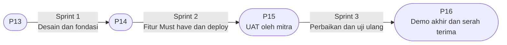

# Team Charter EduLink Tutor

> **Pemilik dokumen:** CEO / Product Owner (Indah Khoerunisa), disepakati seluruh anggota tim &nbsp;|&nbsp; **Periode:** Sprint Akhir P13 sampai P16

Team charter (piagam tim) adalah kesepakatan tentang tujuan, peran, dan aturan kerja tim selama pengembangan MVP EduLink Tutor.

## Daftar isi

1. [Keputusan tim](#1-keputusan-tim)
2. [Tujuan dan lingkup tim](#2-tujuan-dan-lingkup-tim)
3. [Susunan tim dan pembagian peran](#3-susunan-tim-dan-pembagian-peran)
4. [Cara kerja dan komunikasi](#4-cara-kerja-dan-komunikasi)
5. [Metode pengerjaan dan jadwal sprint](#5-metode-pengerjaan-dan-jadwal-sprint)
6. [Matriks Definition of Done](#6-matriks-definition-of-done)
7. [Pekerjaan di luar Definition of Done](#7-pekerjaan-di-luar-definition-of-done)
8. [Persetujuan tim](#8-persetujuan-tim)

---

## 1. Keputusan tim

Tim melanjutkan ide yang telah dirancang pada Laporan Tugas Akhir, yaitu **EduLink Tutor**, marketplace guru les privat milik PT EduLink Teknologi Indonesia. Keputusan ini diambil dengan empat pertimbangan:

1. **Kebutuhan nyata.** Orang tua dan siswa ingin memilih tutor sendiri, membandingkan tarif, memeriksa jadwal, dan memesan tanpa harus datang ke bimbingan belajar.
2. **Peluang bisnis nyata.** Platform membuka pendapatan baru (komisi dan biaya layanan) dan memperluas pasar yang selama ini dibatasi lokasi bimbel fisik.
3. **Perancangan yang telah matang.** Laporan telah memuat arsitektur bisnis, data, aplikasi, dan teknologi, serta analisis kesenjangan dan peta jalan.
4. **Dapat diperluas.** Rancangan bertahap dan modular, sehingga MVP dapat dikembangkan ke pembayaran digital penuh, pembelajaran online, laporan terpadu, dan wilayah lain.

## 2. Tujuan dan lingkup tim

**Tujuan.** Menyiapkan rancangan dan MVP EduLink Tutor yang menunjukkan alur utama platform: tutor mendaftar dan diverifikasi, orang tua atau siswa mencari dan memesan tutor, pembayaran diproses, dan hasil layanan dinilai.

**Lingkup.** Mengikuti fase perancangan pada laporan dan dibatasi pada hal yang realistis dikerjakan dalam **empat minggu (P13 sampai P16)**.

**Di luar lingkup.** Integrasi langsung dengan EduManage yang sebenarnya, estimasi biaya rinci, dan penerapan di lingkungan produksi nyata.

## 3. Susunan tim dan pembagian peran

| No | Peran | Nama | NIM |
|:-:|---|---|:-:|
| 1 | CEO / Product Owner (PO) | Indah Khoerunisa | F1E124070 |
| 2 | SA / UI-UX | Nabilla Meylanty | F1E124031 |
| 3 | Programmer + Database | Muhamad Maulana Riski | F1E124012 |
| 4 | Network | Arron Willard Wijaya | F1E124007 |
| 5 | QA | Nasywa Yafi Arsa | F1E124001 |

Peran Programmer dan Database digabung menjadi satu. Peran QA (Quality Assurance, penjaminan mutu) dipisahkan dari Network agar pengujian dan pencatatan tim punya penanggung jawab sendiri dan terhindar dari bias.

| Peran | Tanggung jawab utama |
|---|---|
| **CEO / PO** | Menjaga arah dan nilai produk, menetapkan urutan prioritas fitur, menjadi penghubung dengan mitra, dan mengambil keputusan akhir apabila tim tidak mencapai kesepakatan |
| **SA / UI-UX** | Mengubah kebutuhan menjadi proses bisnis, use case, dan user story, serta merancang tampilan dan kenyamanan penggunaan aplikasi |
| **Programmer + Database** | Membangun aplikasi dengan pola yang rapi, mengelola repositori kode, serta merancang dan membuat basis data |
| **Network** | Merancang topologi jaringan dan kebutuhan hosting, serta memastikan sistem baru ditempatkan secara aman dan tidak mengganggu EduManage |
| **QA** | Menetapkan kebutuhan non-fungsional, memeriksa hasil pekerjaan terhadap kriteria penerimaan, dan mencatat notulen stand-up |

### Matriks RACI per keluaran

R = Responsible (mengerjakan), A = Accountable (penanggung jawab akhir), C = Consulted (dimintai masukan), I = Informed (diberi tahu).

| Keluaran (folder repositori) | CEO / PO | SA / UI-UX | Programmer + Database | Network | QA |
|---|:-:|:-:|:-:|:-:|:-:|
| Vision, stakeholder, team charter (`00_Vision`) | **A/R** | C | C | C | C |
| BPMN dan BMC (`01_Business`) | A (BMC: R) | R (BPMN) | I | I | C |
| ERD, kamus data, SQL (`02_Data`) | I | C | **A/R** | I | C |
| Use case, user story, prototipe (`03_Application`) | A | **R** | C | I | C |
| Topologi, deployment, keamanan, TCO (`04_Technology`) | A | I | C | **R** | C |
| Gap analysis, roadmap (`05_Opportunities`) | **A/R** | C | C | C | I |
| ADR, log CR, change management (`06_Governance`) | **A/R** | C | C | C | C |
| UAT, SUS, notulen (`07_Evidence`) | A | R (skenario, SUS) | C | I | **R** |
| Repo, tag v1.0, changelog, manual (`08_Source`) | A | C | **R** | C | C |
| Deck final (`09_Pitch`) | **A/R** | R | C | C | C |

> Matriks RACI ini diturunkan dari pembagian tugas P13 dan P14 serta struktur Architecture Repository. Penanggung jawab akhir setiap folder adalah CEO / PO sesuai perannya sebagai pemilik produk.

## 4. Cara kerja dan komunikasi

| Aspek | Kesepakatan |
|---|---|
| **Stand-up rutin** | Setiap anggota menyampaikan apa yang telah dikerjakan, rencana berikutnya, dan kendala. QA mencatat hasilnya sebagai notulen. |
| **Pengambilan keputusan** | Melalui musyawarah. Apabila tidak tercapai kesepakatan, CEO / PO memutuskan setelah mendengar pertimbangan semua anggota. |
| **Penyimpanan hasil kerja** | Dokumen disimpan di folder bersama dan repositori arsitektur ini. Kode disimpan di repositori bersama dengan aturan cabang `main`, `dev`, dan `feature/*`. |
| **Kendala** | Hambatan segera disampaikan kepada tim tanpa menunggu pertemuan berikutnya, agar pekerjaan lain tidak ikut tertunda. |
| **Perbedaan pendapat** | Dibahas berdasarkan tujuan proyek dan kebutuhan pengguna, bukan kepentingan pribadi. |
| **Perubahan lingkup** | Setelah surat konfirmasi mitra terbit, perubahan lingkup hanya dapat dilakukan atas persetujuan tertulis kedua pihak melalui CEO / PO. |

## 5. Metode pengerjaan dan jadwal sprint

Tim menggunakan **Scrum yang disederhanakan**. Scrum adalah kerangka kerja agile (cara kerja bertahap dan adaptif) yang membagi pekerjaan ke dalam iterasi pendek bernama sprint.

- Satu sprint berlangsung **satu minggu**, dimulai pada satu pertemuan dan ditutup pada pertemuan berikutnya.
- Sprint Akhir terdiri atas **tiga sprint mingguan** dan **satu sesi penutupan** pada P16.
- Backlog diambil dari user story dan diurutkan menurut prioritas MoSCoW pada [Vision](01_Vision.md#7-prioritas-fitur-moscow).
- Setiap sprint diawali perencanaan singkat di kelas, diisi stand-up rutin, dan ditutup dengan review hasil terhadap Definition of Done.

| Sprint | Periode | Sasaran | Keluaran yang diperiksa |
|---|:-:|---|---|
| **Sprint 1** | P13 sampai P14 | Desain dan fondasi proyek | Vision, MoSCoW, DoD, BPMN, use case, user story, wireframe, ERD, kamus data, topologi; konfirmasi mitra, BMC, prototipe Figma, DDL, data tiruan, proyek lokal dengan login dan peran, README, opsi hosting, deployment diagram |
| **Sprint 2** | P14 sampai P15 | Fitur Must have dan deploy | Minimal US01 sampai US04 selesai, US05 sampai US07 diselesaikan sebelum UAT; aplikasi dideploy ke Railway; akun uji per peran dan skenario UAT S01 sampai S09 siap |
| **Sprint 3** | P15 sampai P16 | UAT dan perbaikan | UAT oleh mitra pada P15, perbaikan cacat dan uji ulang, fitur Should have apabila waktu mencukupi |
| **Penutupan** | P16 | Demo akhir dan serah terima | Demo aplikasi di Railway, persetujuan hasil UAT, laporan akhir dan Architecture Repository lengkap (dikumpulkan H-1 sebelum P16) |

## 6. Matriks Definition of Done

Definition of Done (DoD) adalah batasan kapan suatu pekerjaan dianggap benar-benar selesai. DoD disusun dalam tiga tingkat mengikuti pola **Definition of Done Canvas**. Suatu pekerjaan baru dinyatakan selesai apabila **seluruh kriteria pada tingkatnya terpenuhi dan buktinya dapat ditunjukkan**.

### A. Tingkat item backlog (setiap user story)

Diperiksa setiap kali satu user story diajukan selesai.

| Kode | Kriteria selesai | Bukti terukur | Penanggung jawab |
|:-:|---|---|---|
| DoD-B1 | Kriteria penerimaan user story terpenuhi | Seluruh butir kriteria penerimaan dinyatakan lulus oleh QA | QA |
| DoD-B2 | Kode digabung ke cabang `dev` melalui pull request | Pull request ditinjau dan disetujui minimal satu anggota lain | Programmer + Database |
| DoD-B3 | Lolos uji fungsi tanpa cacat kritis | Hasil uji tercatat dan jumlah cacat kritis terbuka 0 | QA |
| DoD-B4 | Hak akses sesuai peran | Uji login sebagai orang tua, tutor, dan admin: setiap peran hanya membuka menunya sendiri | QA |
| DoD-B5 | Tampilan sesuai prototipe dan responsif | Halaman dicek di laptop dan ponsel terhadap prototipe Figma | SA / UI-UX |
| DoD-B6 | Hanya menggunakan data tiruan | Seeder dan data uji tidak memuat data pribadi yang sebenarnya | Programmer + Database |

### B. Tingkat sprint (setiap pertemuan)

Diperiksa saat review pada awal pertemuan berikutnya.

| Kode | Kriteria selesai | Bukti terukur | Penanggung jawab | Waktu periksa |
|:-:|---|---|---|---|
| DoD-S1 | Backlog sprint diperbarui | Setiap item berstatus selesai atau dipindah ke sprint berikutnya, tercatat di notulen | CEO / PO | Setiap review |
| DoD-S2 | Cabang `main` dapat dijalankan dan didemonstrasikan | Demo di komputer lokal (Sprint 1) dan di Railway (mulai Sprint 2) | Programmer + Database, Network | Setiap review |
| DoD-S3 | Alur utama tetap berjalan setelah penggabungan | Skenario S01 sampai S07 dijalankan ulang tanpa gagal (uji regresi) | QA | Sprint 2 dan 3 |
| DoD-S4 | Kinerja sesuai kebutuhan non-fungsional | Waktu muat halaman utama dan pencarian tidak lebih dari 3 detik | QA, Network | Sprint 2 dan 3 |
| DoD-S5 | Dokumentasi diperbarui | README, laporan, dan notulen stand-up memuat hasil sprint | Semua peran | Setiap review |
| DoD-S6 | Hasil sprint disetujui | Persetujuan CEO / PO dicatat pada notulen review | CEO / PO | Setiap review |

### C. Tingkat rilis (UAT dan penutupan)

| Kode | Kriteria selesai | Bukti terukur | Penanggung jawab | Waktu periksa |
|:-:|---|---|---|:-:|
| DoD-R1 | Seluruh skenario Must have lulus UAT | Lembar hasil UAT S01 sampai S07 berstatus lulus dan disetujui penguji mitra | QA, CEO / PO | P15 |
| DoD-R2 | Target KPI periode UAT tercapai | 30 tutor valid, 20 pesanan dibayar, minimal 90% pembayaran sandbox berhasil | CEO / PO | P15 |
| DoD-R3 | Cacat temuan UAT diperbaiki | Jumlah cacat kritis terbuka 0 setelah uji ulang | Programmer + Database, QA | Sebelum P16 |
| DoD-R4 | Demo akhir dan laporan diserahkan | Aplikasi dapat diakses di Railway dan laporan akhir lengkap | Semua peran | P16 |

## 7. Pekerjaan di luar Definition of Done

Pekerjaan berikut dibutuhkan sebelum EduLink Tutor digunakan pengguna sebenarnya, tetapi sengaja tidak dimasukkan ke DoD Sprint Akhir karena waktu hanya empat minggu dan lingkup MVP telah dibatasi (undone work).

| Pekerjaan | Alasan belum dikerjakan | Rencana tindak lanjut |
|---|---|---|
| Integrasi langsung dengan EduManage | Berstatus Won't have dan akses ke sistem asli belum tersedia | Fase implementasi melalui API Gateway dan VPN |
| Lingkungan Staging dan Production terpisah, backup terkelola, monitoring | Hosting MVP hanya Railway paket gratis | Disiapkan saat penerapan penuh sesuai topologi To-Be |
| Uji beban dan uji stres | Memerlukan lingkungan setara Production dan waktu lebih panjang | Sebelum peluncuran publik |
| Audit keamanan menyeluruh (uji penetrasi) | Di luar waktu empat minggu; MVP hanya diuji hak akses per peran dan HTTPS | Sebelum data pengguna sebenarnya digunakan |
| Pembayaran dengan uang sungguhan | MVP hanya menggunakan pembayaran sandbox | Setelah skema komisi disahkan manajemen |
| Single Sign-On dan penskalaan otomatis | Berstatus Won't have | Mengikuti peta jalan Laporan Tugas Akhir |

DoD dapat diperketat bertahap. Apabila satu sprint selesai lebih cepat, CEO / PO dapat memindahkan satu pekerjaan dari tabel ini ke DoD sprint berikutnya, lalu mencatat perubahannya pada notulen stand-up.

## 8. Persetujuan tim

Dengan ini seluruh anggota tim menyetujui isi team charter ini sebagai pegangan kerja selama Sprint Akhir P13 sampai P16.

| Peran | Nama | NIM | Tanda tangan |
|---|---|:-:|:-:|
| CEO / Product Owner | Indah Khoerunisa | F1E124070 |  |
| SA / UI-UX | Nabilla Meylanty | F1E124031 |  |
| Programmer + Database | Muhamad Maulana Riski | F1E124012 |  |
| Network | Arron Willard Wijaya | F1E124007 |  |
| QA | Nasywa Yafi Arsa | F1E124001 |  |

---

**Dokumen terkait:** [Vision v1.0](01_Vision.md) · [Stakeholder](02_Stakeholder.md) · [Business Model Canvas](../01_Business/01_Business_Model_Canvas.md)
