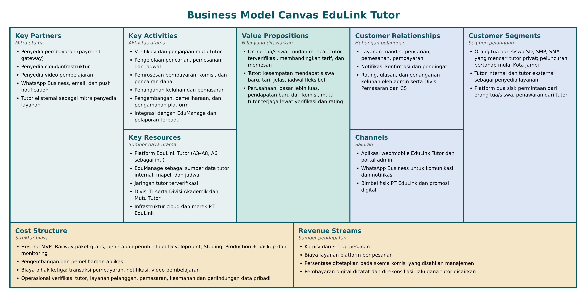
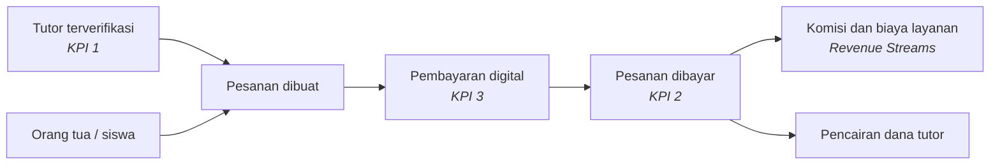

# Business Model Canvas EduLink Tutor

> **Pemilik dokumen:** CEO / Product Owner (Indah Khoerunisa) &nbsp;|&nbsp; **Status:** Usulan, divalidasi bersama manajemen mitra saat penetapan skema komisi

Business Model Canvas (BMC) adalah gambaran model bisnis dalam satu halaman yang terdiri atas sembilan blok. BMC ini disusun dari [Vision v1.0](../00_Vision/01_Vision.md), [katalog stakeholder](../00_Vision/02_Stakeholder.md), value chain, Solution Concept Diagram, dan analisis kesenjangan pada Laporan Tugas Akhir. Karena itu, BMC tidak memuat pihak atau angka baru di luar dokumen tersebut.

## Daftar isi

1. [Kanvas](#1-kanvas)
2. [Rincian sembilan blok](#2-rincian-sembilan-blok)
3. [Kaitan dengan KPI](#3-kaitan-dengan-kpi)
4. [Catatan dan asumsi](#4-catatan-dan-asumsi)

---

## 1. Kanvas

<table>
  <tr>
    <td rowspan="2" width="20%" valign="top">
      <b>Key Partners</b> <i>Mitra utama</i>  
      • Penyedia pembayaran (payment gateway) 
      • Penyedia cloud/infrastruktur 
      • Penyedia video pembelajaran 
      • WhatsApp Business, email, dan push notification 
      • Tutor eksternal sebagai mitra penyedia layanan
    </td>
    <td width="20%" valign="top">
      <b>Key Activities</b> <i>Aktivitas utama</i>  
      • Verifikasi dan penjagaan mutu tutor 
      • Pengelolaan pencarian, pemesanan, dan jadwal 
      • Pemrosesan pembayaran, komisi, dan pencairan dana 
      • Penanganan keluhan dan pemasaran 
      • Pengembangan, pemeliharaan, dan pengamanan platform 
      • Integrasi dengan EduManage dan pelaporan terpadu
    </td>
    <td rowspan="2" width="20%" valign="top">
      <b>Value Propositions</b> <i>Nilai yang ditawarkan</i>  
      • <b>Orang tua/siswa:</b> mudah mencari tutor terverifikasi, membandingkan tarif, dan memesan  
      • <b>Tutor:</b> kesempatan memperoleh siswa baru, tarif jelas, dan jadwal fleksibel  
      • <b>Perusahaan:</b> pasar lebih luas, pendapatan baru dari komisi, dan mutu tutor terjaga melalui verifikasi serta rating
    </td>
    <td width="20%" valign="top">
      <b>Customer Relationships</b> <i>Hubungan pelanggan</i>  
      • Layanan mandiri untuk pencarian, pemesanan, dan pembayaran 
      • Notifikasi konfirmasi dan pengingat 
      • Rating, ulasan, dan penanganan keluhan oleh admin serta Divisi Pemasaran dan CS
    </td>
    <td rowspan="2" width="20%" valign="top">
      <b>Customer Segments</b> <i>Segmen pelanggan</i>  
      • Orang tua dan siswa SD, SMP, SMA yang mencari tutor privat, dengan peluncuran bertahap mulai Kota Jambi  
      • Tutor internal dan tutor eksternal sebagai penyedia layanan  
      • Platform dua sisi: permintaan dari orang tua/siswa, penawaran dari tutor
    </td>
  </tr>
  <tr>
    <td valign="top">
      <b>Key Resources</b> <i>Sumber daya utama</i>  
      • Platform EduLink Tutor (A3–A8, A6 sebagai layanan inti) 
      • EduManage sebagai sumber data tutor internal, mata pelajaran, dan jadwal 
      • Jaringan tutor terverifikasi 
      • Divisi TI serta Divisi Akademik dan Mutu Tutor 
      • Infrastruktur cloud dan merek PT EduLink
    </td>
    <td valign="top">
      <b>Channels</b> <i>Saluran</i>  
      • Aplikasi web/mobile EduLink Tutor dan portal admin 
      • WhatsApp Business untuk komunikasi dan notifikasi 
      • Bimbel fisik PT EduLink dan promosi digital
    </td>
  </tr>
  <tr>
    <td colspan="2" valign="top">
      <b>Cost Structure</b> <i>Struktur biaya</i>  
      • Hosting: MVP menggunakan Railway paket gratis; penerapan penuh memerlukan cloud untuk Development, Staging, dan Production beserta backup dan monitoring 
      • Pengembangan dan pemeliharaan aplikasi 
      • Biaya pihak ketiga: transaksi pembayaran, notifikasi, video pembelajaran 
      • Operasional verifikasi tutor, layanan pelanggan, pemasaran, serta keamanan dan perlindungan data pribadi
    </td>
    <td colspan="3" valign="top">
      <b>Revenue Streams</b> <i>Sumber pendapatan</i>  
      • Komisi dari setiap pesanan 
      • Biaya layanan platform per pesanan 
      • Persentase ditetapkan pada skema komisi yang disahkan manajemen 
      • Pembayaran digital dicatat dan direkonsiliasi, lalu dana tutor dicairkan
    </td>
  </tr>
</table>

## 2. Rincian sembilan blok

| No | Blok | Isi | Sumber / keterkaitan |
|:-:|---|---|---|
| 1 | **Customer Segments** (segmen pelanggan) | Orang tua dan siswa SD, SMP, SMA yang mencari tutor privat, dengan peluncuran publik bertahap mulai Kota Jambi. Tutor internal dan eksternal sebagai penyedia layanan. Platform bersifat dua sisi. | Stakeholder S7, S8, S9 |
| 2 | **Value Propositions** (nilai yang ditawarkan) | Orang tua/siswa: mudah mencari tutor terverifikasi, membandingkan tarif, dan memesan. Tutor: siswa baru, tarif jelas, jadwal fleksibel. Perusahaan: pasar lebih luas, pendapatan komisi, mutu tutor terjaga. | Vision v1.0, bagian Nilai |
| 3 | **Channels** (saluran) | Aplikasi web/mobile EduLink Tutor dan portal admin; WhatsApp Business; bimbel fisik PT EduLink dan promosi digital. | Aplikasi A2, A3, A4, A5 |
| 4 | **Customer Relationships** (hubungan pelanggan) | Layanan mandiri untuk pencarian, pemesanan, dan pembayaran; notifikasi konfirmasi dan pengingat; rating, ulasan, dan penanganan keluhan. | Use case UC05 sampai UC10; stakeholder S6 |
| 5 | **Revenue Streams** (sumber pendapatan) | Komisi per pesanan dan biaya layanan platform. Persentase ditetapkan pada skema komisi yang disahkan manajemen. Pembayaran dicatat, direkonsiliasi, lalu dana tutor dicairkan. | Stakeholder S5; aplikasi A9 |
| 6 | **Key Resources** (sumber daya utama) | Platform EduLink Tutor (A3 sampai A8, A6 sebagai inti); EduManage; jaringan tutor terverifikasi; Divisi TI serta Divisi Akademik dan Mutu; infrastruktur cloud; merek PT EduLink. | Application Portfolio A1, A3 sampai A8 |
| 7 | **Key Activities** (aktivitas utama) | Verifikasi dan mutu tutor; pencarian, pemesanan, dan jadwal; pembayaran, komisi, dan pencairan; keluhan dan pemasaran; pengembangan dan pengamanan platform; integrasi EduManage dan pelaporan terpadu. | Value chain To-Be |
| 8 | **Key Partners** (mitra utama) | Payment gateway; penyedia cloud/infrastruktur; penyedia video pembelajaran; WhatsApp Business, email, dan push notification; tutor eksternal. | Stakeholder S9, S10, S11; aplikasi A9 sampai A11 |
| 9 | **Cost Structure** (struktur biaya) | Hosting (MVP: Railway gratis; penuh: cloud tiga lingkungan dengan backup dan monitoring); pengembangan dan pemeliharaan; biaya pihak ketiga; operasional verifikasi, layanan pelanggan, pemasaran, keamanan, dan perlindungan data. | Folder `04_Technology` (hosting dan TCO) |

## 3. Kaitan dengan KPI

Ketiga KPI pada [Vision v1.0](../00_Vision/01_Vision.md#6-tiga-kpi) mengukur blok utama model bisnis ini.

| KPI | Blok yang diukur | Penjelasan |
|---|---|---|
| Jumlah tutor terverifikasi | Customer Segments (sisi penawaran), Key Activities | Menunjukkan apakah sisi tutor cukup kuat dan proses verifikasi berjalan |
| Jumlah pesanan per bulan | Customer Segments (sisi permintaan), Revenue Streams | Menunjukkan minat orang tua/siswa sekaligus dasar pendapatan komisi |
| Persentase pembayaran digital yang berhasil | Revenue Streams, Key Partners | Menunjukkan kelancaran aliran pendapatan dan keandalan payment gateway |

## 4. Catatan dan asumsi

- **Persentase komisi dan biaya layanan belum ditetapkan.** Angka tersebut menjadi bagian skema komisi yang disahkan manajemen pada paket kerja kebijakan dan tata kelola.
- **Pada MVP**, pembayaran hanya berjalan dalam mode sandbox, perhitungan komisi dan pencairan dana berstatus Could have, dan integrasi EduManage diganti data tiruan.
- **Hosting MVP** menggunakan Railway paket gratis untuk demo dan UAT. Biaya infrastruktur 12 bulan (TCO) untuk penerapan penuh dibahas di folder `04_Technology`.
- BMC ini masih berupa **usulan** dan perlu divalidasi bersama manajemen mitra bersamaan dengan penetapan skema komisi.

---

**Dokumen terkait:** [Vision v1.0](../00_Vision/01_Vision.md) · [Stakeholder](../00_Vision/02_Stakeholder.md) · [Team Charter](../00_Vision/03_Team_Charter.md)
