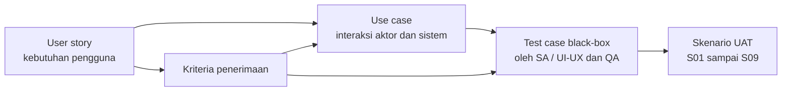

# User Story dan Kriteria Penerimaan EduLink Tutor

> **Pemilik dokumen:** SA / UI-UX (Nabilla Meylanty) &nbsp;|&nbsp; **Pemeriksa:** QA (Nasywa Yafi Arsa) &nbsp;|&nbsp; **Status:** Disetujui sebagai backlog MVP Sprint Akhir P13 sampai P16

Dokumen ini memuat kebutuhan pengguna EduLink Tutor dalam bentuk user story beserta kriteria penerimaannya. User story menjadi **landasan penyusunan use case**, sumber backlog pengembangan, dan dasar pengujian oleh QA maupun UAT oleh mitra.

## Daftar isi

1. [Pengertian dan format](#1-pengertian-dan-format)
2. [Peran pengguna](#2-peran-pengguna)
3. [Ringkasan backlog](#3-ringkasan-backlog)
4. [Rincian user story](#4-rincian-user-story)
5. [User story sebagai landasan use case](#5-user-story-sebagai-landasan-use-case)
6. [Ketentuan pengujian](#6-ketentuan-pengujian)

---

## 1. Pengertian dan format

**User story** adalah uraian singkat tentang kebutuhan pengguna yang ditulis dari sudut pandang pengguna itu sendiri. Setiap user story ditulis dengan pola berikut.

```text
Sebagai  <peran pengguna>,
saya ingin <kebutuhan atau tindakan>,
agar     <manfaat yang diperoleh>.
```

**Kriteria penerimaan** (acceptance criteria) adalah syarat yang harus terpenuhi agar suatu user story dinyatakan selesai. Kriteria ini menjadi dasar pengujian oleh QA. Pada dokumen ini, kriteria penerimaan disajikan dalam dua bentuk:

| Bentuk | Fungsi |
|---|---|
| **Daftar periksa** | Butir syarat yang dicentang QA saat pengujian. Setiap butir diberi kode, misalnya `AC-01.1`. |
| **Skenario Diberikan, Ketika, Maka** | Penjabaran kriteria utama dalam format *Given, When, Then*: kondisi awal, tindakan pengguna, dan hasil yang diharapkan. Format ini memudahkan penyusunan test case dan skenario UAT. |

Prioritas mengikuti pengelompokan **MoSCoW** pada [Vision v1.0](../00_Vision/01_Vision.md#7-prioritas-fitur-moscow): *Must have* wajib tersedia pada MVP, sedangkan *Should have* sebaiknya tersedia tetapi pemesanan tetap dapat berjalan tanpanya.

## 2. Peran pengguna

| Peran | Keterangan | Stakeholder terkait |
|---|---|---|
| **Orang tua / siswa** | Mencari, memesan, membayar, dan menilai tutor | S7 |
| **Tutor** | Mendaftar, mengelola profil dan jadwal, serta menanggapi pesanan | S8 (internal), S9 (eksternal) |
| **Admin** | Memverifikasi tutor serta memantau pesanan dan keluhan | S4 |

Rincian stakeholder tersedia pada [dokumen Stakeholder](../00_Vision/02_Stakeholder.md).

## 3. Ringkasan backlog

Terdapat **delapan user story**: tujuh berprioritas *Must have* dan satu berprioritas *Should have*.

| ID | Judul | Peran | Prioritas | Use case | Jumlah kriteria |
|:-:|---|---|:-:|:-:|:-:|
| [US01](#us01--registrasi-dan-login-berbasis-peran) | Registrasi dan login berbasis peran | Orang tua, tutor | Must | UC01 | 4 |
| [US02](#us02--pendaftaran-tutor-dan-unggah-dokumen) | Pendaftaran tutor dan unggah dokumen | Tutor | Must | UC02 | 3 |
| [US03](#us03--verifikasi-pendaftaran-tutor) | Verifikasi pendaftaran tutor | Admin | Must | UC03 | 4 |
| [US04](#us04--pengelolaan-profil-dan-jadwal-tutor) | Pengelolaan profil dan jadwal tutor | Tutor | Must | UC04 | 3 |
| [US05](#us05--pencarian-tutor-dengan-filter) | Pencarian tutor dengan filter | Orang tua | Must | UC05 | 3 |
| [US06](#us06--pemesanan-tutor) | Pemesanan tutor | Orang tua, tutor | Must | UC06, UC07 | 4 |
| [US07](#us07--pembayaran-digital) | Pembayaran digital | Orang tua | Must | UC08 | 4 |
| [US08](#us08--rating-dan-ulasan) | Rating dan ulasan | Orang tua | Should | UC09 | 4 |

---

## 4. Rincian user story

### US01 · Registrasi dan Login Berbasis Peran

| Atribut | Nilai |
|---|---|
| Peran | Orang tua / siswa, tutor |
| Prioritas | Must have |
| Use case | UC01 Registrasi dan login akun |
| Skenario UAT | S01 |

> **Sebagai** orang tua atau tutor,
> **saya ingin** membuat akun dan masuk ke aplikasi,
> **agar** dapat menggunakan layanan sesuai peran saya.

**Kriteria penerimaan**

- [ ] **AC-01.1** Akun dapat dibuat dengan data yang valid.
- [ ] **AC-01.2** Kata sandi tersimpan dalam bentuk terenkripsi (hash).
- [ ] **AC-01.3** Setelah login, menu yang tampil sesuai dengan peran pengguna.
- [ ] **AC-01.4** Login yang gagal menampilkan pesan kesalahan.

**Skenario**

```gherkin
Skenario: Login berhasil sesuai peran
  Diberikan pengguna telah memiliki akun dengan peran "tutor"
  Ketika pengguna memasukkan email dan kata sandi yang benar
  Maka pengguna masuk ke aplikasi
  Dan menu yang tampil hanya menu untuk peran tutor

Skenario: Login gagal
  Diberikan pengguna berada di halaman login
  Ketika pengguna memasukkan kata sandi yang salah
  Maka sistem menampilkan pesan kesalahan
  Dan pengguna tetap berada di halaman login
```

---

### US02 · Pendaftaran Tutor dan Unggah Dokumen

| Atribut | Nilai |
|---|---|
| Peran | Tutor |
| Prioritas | Must have |
| Use case | UC02 Mendaftar sebagai tutor dan unggah dokumen |
| Skenario UAT | S02 |

> **Sebagai** tutor,
> **saya ingin** mendaftar dan mengunggah dokumen,
> **agar** profil saya dapat diverifikasi.

**Kriteria penerimaan**

- [ ] **AC-02.1** Formulir memuat data diri, pendidikan, pengalaman, mata pelajaran, tarif, dan lokasi.
- [ ] **AC-02.2** Dokumen pendukung dapat diunggah.
- [ ] **AC-02.3** Data yang belum lengkap tidak dapat dikirim.

**Skenario**

```gherkin
Skenario: Pendaftaran lengkap berhasil dikirim
  Diberikan tutor telah login dan membuka formulir pendaftaran
  Ketika tutor mengisi seluruh data dan mengunggah dokumen
  Dan tutor menekan tombol kirim
  Maka pendaftaran tersimpan dengan status "menunggu verifikasi"

Skenario: Pendaftaran belum lengkap
  Diberikan tutor belum mengisi data tarif
  Ketika tutor menekan tombol kirim
  Maka sistem menolak pengiriman
  Dan menandai kolom yang belum diisi
```

---

### US03 · Verifikasi Pendaftaran Tutor

| Atribut | Nilai |
|---|---|
| Peran | Admin |
| Prioritas | Must have |
| Use case | UC03 Memverifikasi tutor |
| Skenario UAT | S03 |

> **Sebagai** admin,
> **saya ingin** memeriksa dan memutuskan pendaftaran tutor,
> **agar** hanya tutor yang layak yang tampil di platform.

**Kriteria penerimaan**

- [ ] **AC-03.1** Admin dapat melihat daftar pendaftar beserta dokumennya.
- [ ] **AC-03.2** Admin dapat menyetujui atau menolak pendaftaran.
- [ ] **AC-03.3** Tutor menerima pemberitahuan hasil verifikasi.
- [ ] **AC-03.4** Hanya tutor berstatus valid yang muncul di hasil pencarian.

**Skenario**

```gherkin
Skenario: Admin menyetujui pendaftaran tutor
  Diberikan terdapat pendaftar dengan status "menunggu verifikasi"
  Ketika admin memeriksa dokumen dan memilih "setujui"
  Maka status tutor berubah menjadi "valid"
  Dan tutor menerima pemberitahuan hasil verifikasi
  Dan tutor tersebut muncul di hasil pencarian

Skenario: Admin menolak pendaftaran tutor
  Diberikan terdapat pendaftar dengan dokumen yang tidak sesuai
  Ketika admin memilih "tolak"
  Maka status tutor berubah menjadi "ditolak"
  Dan tutor tersebut tidak muncul di hasil pencarian
```

---

### US04 · Pengelolaan Profil dan Jadwal Tutor

| Atribut | Nilai |
|---|---|
| Peran | Tutor |
| Prioritas | Must have |
| Use case | UC04 Mengelola profil dan jadwal ketersediaan |
| Skenario UAT | S04 |

> **Sebagai** tutor,
> **saya ingin** mengatur profil dan jadwal,
> **agar** orang tua mengetahui kemampuan dan waktu ketersediaan saya.

**Kriteria penerimaan**

- [ ] **AC-04.1** Tutor dapat mengubah kompetensi, tarif, lokasi, dan foto.
- [ ] **AC-04.2** Tutor dapat menambah, mengubah, dan menghapus slot jadwal.
- [ ] **AC-04.3** Slot yang telah terisi tidak dapat dipesan ulang.

**Skenario**

```gherkin
Skenario: Tutor menambah slot jadwal
  Diberikan tutor berstatus valid telah login
  Ketika tutor menambahkan slot jadwal hari Senin pukul 16.00 sampai 17.30
  Maka slot tersebut tersimpan dengan status "tersedia"
  Dan slot tampil pada profil tutor

Skenario: Slot terisi tidak dapat dipesan ulang
  Diberikan slot jadwal tutor berstatus "terisi"
  Ketika orang tua lain mencoba memesan slot tersebut
  Maka slot tidak dapat dipilih
```

---

### US05 · Pencarian Tutor dengan Filter

| Atribut | Nilai |
|---|---|
| Peran | Orang tua / siswa |
| Prioritas | Must have |
| Use case | UC05 Mencari tutor dan melihat profil |
| Skenario UAT | S05 |

> **Sebagai** orang tua,
> **saya ingin** mencari tutor dengan filter,
> **agar** menemukan tutor yang sesuai dengan kebutuhan anak.

**Kriteria penerimaan**

- [ ] **AC-05.1** Pencarian dapat difilter menurut mata pelajaran, jenjang, lokasi, tarif, dan rating.
- [ ] **AC-05.2** Hasil pencarian menampilkan tarif, rating, dan jadwal yang tersedia.
- [ ] **AC-05.3** Pesan "tidak ditemukan" muncul apabila tidak ada hasil.

**Skenario**

```gherkin
Skenario: Pencarian dengan filter menemukan tutor
  Diberikan terdapat tutor valid untuk mata pelajaran Matematika jenjang SMP di Kota Jambi
  Ketika orang tua memfilter mata pelajaran "Matematika", jenjang "SMP", dan lokasi "Kota Jambi"
  Maka sistem menampilkan daftar tutor yang sesuai
  Dan setiap hasil memuat tarif, rating, dan jadwal yang tersedia

Skenario: Pencarian tanpa hasil
  Diberikan tidak ada tutor yang sesuai dengan filter
  Ketika orang tua menjalankan pencarian
  Maka sistem menampilkan pesan "tidak ditemukan"
```

---

### US06 · Pemesanan Tutor

| Atribut | Nilai |
|---|---|
| Peran | Orang tua / siswa (memesan), tutor (menanggapi) |
| Prioritas | Must have |
| Use case | UC06 Memesan tutor, UC07 Menanggapi pesanan |
| Skenario UAT | S06 |

> **Sebagai** orang tua,
> **saya ingin** memesan tutor pada jadwal tertentu,
> **agar** anak saya mendapat les sesuai waktu yang diinginkan.

**Kriteria penerimaan**

- [ ] **AC-06.1** Pesanan memuat siswa, tutor, mata pelajaran, jadwal, durasi, dan metode.
- [ ] **AC-06.2** Jadwal ditahan sementara setelah pesanan dibuat.
- [ ] **AC-06.3** Tutor dapat menerima atau menolak pesanan.
- [ ] **AC-06.4** Jadwal yang telah terisi tidak dapat dipesan.

**Skenario**

```gherkin
Skenario: Pesanan dibuat dan diterima tutor
  Diberikan orang tua telah memilih tutor dan slot jadwal yang tersedia
  Ketika orang tua mengirim pesanan
  Maka pesanan tersimpan dengan status "menunggu konfirmasi"
  Dan slot jadwal berubah menjadi "ditahan"
  Ketika tutor menerima pesanan
  Maka status pesanan berubah menjadi "diterima"

Skenario: Pesanan ditolak tutor
  Diberikan terdapat pesanan berstatus "menunggu konfirmasi"
  Ketika tutor menolak pesanan
  Maka status pesanan berubah menjadi "ditolak"
  Dan slot jadwal kembali berstatus "tersedia"
```

---

### US07 · Pembayaran Digital

| Atribut | Nilai |
|---|---|
| Peran | Orang tua / siswa |
| Prioritas | Must have |
| Use case | UC08 Membayar pesanan |
| Skenario UAT | S07 |

> **Sebagai** orang tua,
> **saya ingin** membayar pesanan secara digital,
> **agar** pesanan saya terkonfirmasi.

**Kriteria penerimaan**

- [ ] **AC-07.1** Pembayaran hanya dapat dilakukan pada pesanan yang telah diterima tutor.
- [ ] **AC-07.2** Status pembayaran (pending, berhasil, gagal) tampil dengan jelas.
- [ ] **AC-07.3** Pembayaran yang berhasil mengubah status pesanan menjadi dibayar.
- [ ] **AC-07.4** Pembayaran yang gagal dapat dicoba kembali.

> Pada MVP, pembayaran berjalan dalam **mode sandbox** (lingkungan percobaan tanpa uang sungguhan).

**Skenario**

```gherkin
Skenario: Pembayaran berhasil
  Diberikan pesanan berstatus "diterima"
  Ketika orang tua menyelesaikan pembayaran sandbox
  Maka status pembayaran berubah menjadi "berhasil"
  Dan status pesanan berubah menjadi "dibayar"

Skenario: Pembayaran gagal dan dicoba kembali
  Diberikan pembayaran sebelumnya berstatus "gagal"
  Ketika orang tua memilih "bayar ulang"
  Maka sistem membuat percobaan pembayaran baru

Skenario: Pesanan belum diterima tutor
  Diberikan pesanan berstatus "menunggu konfirmasi"
  Ketika orang tua membuka detail pesanan
  Maka tombol pembayaran tidak tersedia
```

---

### US08 · Rating dan Ulasan

| Atribut | Nilai |
|---|---|
| Peran | Orang tua / siswa |
| Prioritas | Should have |
| Use case | UC09 Memberi rating dan ulasan |
| Skenario UAT | S08 |

> **Sebagai** orang tua,
> **saya ingin** memberi rating dan ulasan,
> **agar** pengguna lain terbantu dalam memilih tutor.

**Kriteria penerimaan**

- [ ] **AC-08.1** Rating hanya dapat diberikan setelah sesi selesai.
- [ ] **AC-08.2** Nilai berskala 1 sampai 5 dan disertai komentar.
- [ ] **AC-08.3** Satu pesanan hanya dapat dinilai satu kali.
- [ ] **AC-08.4** Rata-rata rating tutor diperbarui setelah penilaian.

**Skenario**

```gherkin
Skenario: Memberi rating setelah sesi selesai
  Diberikan pesanan berstatus "selesai" dan belum dinilai
  Ketika orang tua memberi nilai 5 dengan komentar
  Maka ulasan tersimpan
  Dan rata-rata rating tutor diperbarui

Skenario: Pesanan yang sudah dinilai
  Diberikan pesanan telah memiliki ulasan
  Ketika orang tua mencoba menilai pesanan yang sama
  Maka sistem menolak penilaian kedua
```

---

## 5. User story sebagai landasan use case

User story menjelaskan **kebutuhan dan manfaat dari sudut pandang pengguna**, sedangkan use case menjelaskan **interaksi langkah demi langkah antara aktor dan sistem** untuk memenuhi kebutuhan tersebut. Karena itu, user story disusun lebih dahulu dan menjadi landasan pembuatan use case.

Penurunan dilakukan dengan ketentuan berikut.

| Unsur user story | Menjadi unsur use case |
|---|---|
| Peran ("Sebagai ...") | **Aktor** |
| Kebutuhan ("saya ingin ...") | **Nama dan tujuan** use case |
| Manfaat ("agar ...") | **Nilai** atau hasil akhir bagi aktor |
| Kriteria penerimaan | **Alur utama, alur alternatif, prasyarat, dan kondisi akhir** |



### Matriks keterlacakan

Matriks berikut menunjukkan hubungan setiap user story dengan use case dan skenario UAT, sehingga setiap kebutuhan pengguna dapat ditelusuri sampai tahap pengujian.

| User story | Use case | Aktor | Skenario UAT | Prioritas |
|:-:|---|---|:-:|:-:|
| US01 | UC01 Registrasi dan login akun | Orang tua/siswa, tutor, admin | S01 | Must |
| US02 | UC02 Mendaftar sebagai tutor dan unggah dokumen | Tutor | S02 | Must |
| US03 | UC03 Memverifikasi tutor | Admin | S03 | Must |
| US04 | UC04 Mengelola profil dan jadwal ketersediaan | Tutor | S04 | Must |
| US05 | UC05 Mencari tutor dan melihat profil | Orang tua | S05 | Must |
| US06 | UC06 Memesan tutor<br>UC07 Menanggapi pesanan | Orang tua, tutor | S06 | Must |
| US07 | UC08 Membayar pesanan | Orang tua/siswa, layanan pembayaran (sandbox) | S07 | Must |
| US08 | UC09 Memberi rating dan ulasan | Orang tua | S08 | Should |
| - | UC10 Memantau pesanan dan menangani keluhan | Admin | S09 | Should |

Catatan:

- **US06 diturunkan menjadi dua use case** karena melibatkan dua aktor dengan tindakan berbeda: orang tua membuat pesanan (UC06), lalu tutor menanggapinya (UC07).
- **UC10 belum memiliki user story.** Use case ini berasal dari kebutuhan operasional admin pada Laporan Tugas Akhir. Apabila diperlukan, user story US09 dapat ditambahkan dengan persetujuan CEO / PO.

## 6. Ketentuan pengujian

- Suatu user story dinyatakan selesai apabila **seluruh butir kriteria penerimaannya lulus** dan memenuhi [Definition of Done](../00_Vision/03_Team_Charter.md#6-matriks-definition-of-done) tingkat item backlog (DoD-B1 sampai DoD-B6).
- Pengujian menggunakan **data tiruan**, bukan data pribadi yang sebenarnya.
- Hasil pengujian dan UAT dicatat pada folder `07_Evidence`.
- Perubahan isi user story setelah lingkup MVP dikonfirmasi mitra dicatat sebagai **Change Request** pada folder `06_Governance`.

---

**Dokumen terkait:** [Vision v1.0](../00_Vision/01_Vision.md) · [Stakeholder](../00_Vision/02_Stakeholder.md) · [Team Charter](../00_Vision/03_Team_Charter.md)
